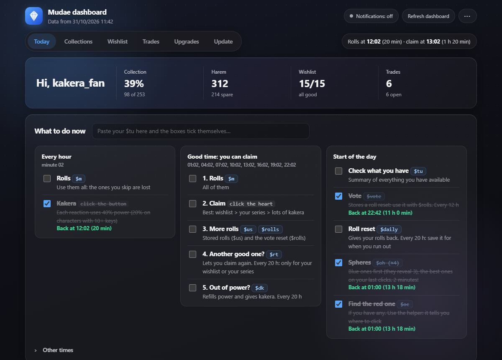
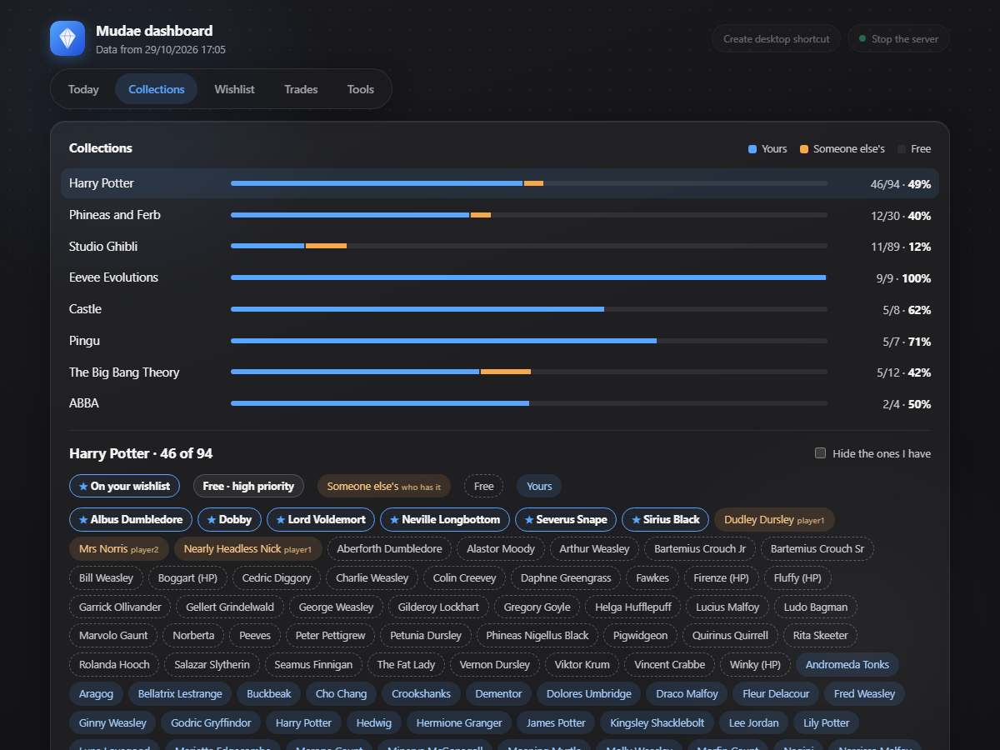
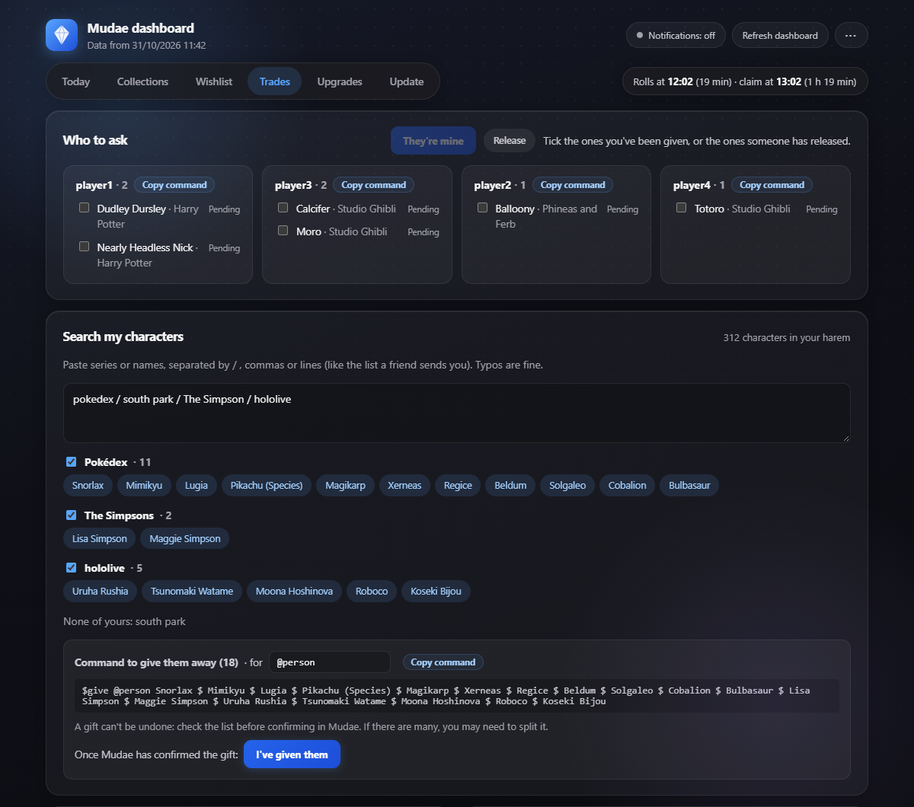

<p align="center"></p>

# Mudae Dashboard

[English](README.md) · **Català** · [Español](README.es.md)

Porta les teves col·leccions de [Mudae](https://mudae.net) al dia sense perdre cap tirada.

Un tauler que s'executa al teu ordinador per al bot de Discord Mudae: hi enganxes el que et diu Mudae i et porta les col·leccions, la wishlist i els intercanvis. Disponible en català, castellà i anglès.

<p align="center">
  
  
  
</p>

_Captures del tauler amb dades d'exemple._

## Instal·lació (5 minuts)

1. Instal·la [Python](https://www.python.org/downloads/) 3.12 o més nou. A la primera pantalla de l'instal·lador, marca «Add python.exe to PATH» (recomanat, tot i que sense també funciona).
2. Clica el botó verd **Code → Download ZIP** a dalt d'aquesta pàgina. Abans de descomprimir-lo: clic dret al ZIP → **Propietats** → marca **«Desbloqueja»** → D'acord (si no, Windows pot bloquejar els `.bat`). Després descomprimeix la carpeta on la vulguis tenir (per exemple, a Documents). No l'obris des de dins del zip.
3. Doble clic a **`Configura.bat`**. Tria l'idioma (el 3 és el català), escriu el teu nom a Mudae (el que surt a «Pertenece a …» als teus personatges) i, si vols, el del servidor. Crea l'accés directe **Mudae** a l'escriptori i obre el tauler.
4. Al tauler, enganxa el que t'envia Mudae a la casella de dalt de la pestanya **Avui**. Endevina què és cada missatge i el desa sol. Per ordre:
   - **El teu harem**: escriu `$mma+s` a Discord, copia el missatge que t'arriba per privat i enganxa'l.
   - **La teva wishlist**: `$wl`.
   - **Cada sèrie que col·lecciones**: `$imaso <sèrie>` (per exemple, `$imaso Harry Potter`). Una sèrie nova t'espera: comprova'n el nom a «Posar al dia» i clica **Desar i actualitzar**.
   - **Després, totes de cop**: a «Posar al dia», tria «Totes les teves sèries», copia l'ordre que surt (`$imaa+os Sèrie 1 $ Sèrie 2 $ …`) i enganxa tots els missatges que et torna Mudae.
   - **El teu servidor i tu**: el requadre **Pendent!**, sota la casella, diu quines ordres falten (`$tu`, `$settings`, `$bonus`, `$k`…). Enganxa-les igual.

A partir d'aquí, obre el tauler amb l'accés directe **Mudae** de l'escriptori.

## Funcions

- **Pestanya Avui:** enganxes qualsevol resposta de Mudae i una llista et diu què toca ara.
- **Rellotge de tirades i reclam** amb avisos quan tornen les tirades, el reclam, el `$daily`, el `$vote`, el `$dk`, el `$rt` o el `$p`.
- **Ajudants del `$oc` i el `$oq`:** et diuen quina casella clicar als jocs d'esferes.
- **Col·leccions:** un àlbum per sèrie, amb els personatges lliures i qui té els altres.
- **Col·leccions especials:** agrupa els personatges que vulguis, encara que no siguin d'una sèrie de Mudae.
- **Wishlist:** t'avisa dels que ja són teus o que ha reclamat algú, i et prepara les ordres.
- **Intercanvis i regals:** prepara l'ordre `$give` i busca entre els teus personatges.
- **Millores:** et diu quina insígnia, pis de la torre o avantatge d'esferes comprar després.
- **Pokédex:** compta els teus Pokémon per raresa.
- **Excel:** el mateix en un full de càlcul que respecta les teves notes.

Més detall, ús diari, configuració i problemes a la [guia](docs/guide.ca.md).

## Bo de saber

- **Sense connexió:** no es connecta a Discord ni a Mudae i no demana cap compte. Només llegeix el que enganxes i ho desa a la carpeta `dades/`.
- **Tanca l'Excel** abans de fer servir els botons del tauler: si és obert, no es pot desar.
- Els botons fan servir un petit servidor que només escolta al teu ordinador (`127.0.0.1`). S'atura sol uns minuts després de tancar la pestanya.
- **No esborris la carpeta `lib`**: hi ha el que necessita el programa per escriure l'Excel.

## Estructura del projecte

<details>
<summary>Fitxers</summary>

| Fitxer | Què fa |
| --- | --- |
| `mudae.py` | tot el programa, amb la llibreria estàndard de Python i openpyxl. Llegeix `dades/`, escriu l'Excel i `dashboard.html`, i fa de servidor local. |
| `i18n.py` | els textos en castellà i anglès (el català fa de clau). |
| `oc.html` | l'ajudant del `$oc`, sense dependències. |
| `oq.html` | l'ajudant del `$oq`, sense dependències. |
| `lib/` | openpyxl i et_xmlfile, inclosos perquè funcioni sense `pip install`. |
| `Configura.bat` / `Actualitza.bat` | la primera configuració i l'accés directe. |

Proves:

```bash
python -m unittest discover tests
node tests/test_oc.mjs
node tests/test_rutina.mjs
node tests/test_millores.mjs
```

Textos sense traduir: `python tools/textos.py`. Un `.zip` net per passar-lo a algú (sense cap dada personal): `python tools/fer_zip.py`.

</details>

## Dades i llicències

- Codi: [MIT](LICENSE).
- Llibreries incloses: openpyxl i et_xmlfile, totes dues MIT (els textos de llicència són a `lib/*.dist-info/`).
- Projecte de fans: no té cap relació amb Mudae ni Discord, que no l'avalen; els seus noms són marques dels seus propietaris.

## Versió

No hi ha versions numerades: el botó **Actualitzar el tauler** instal·la l'última versió de GitHub.

---

Developed by [Vlarac](https://github.com/Vlarac03)
