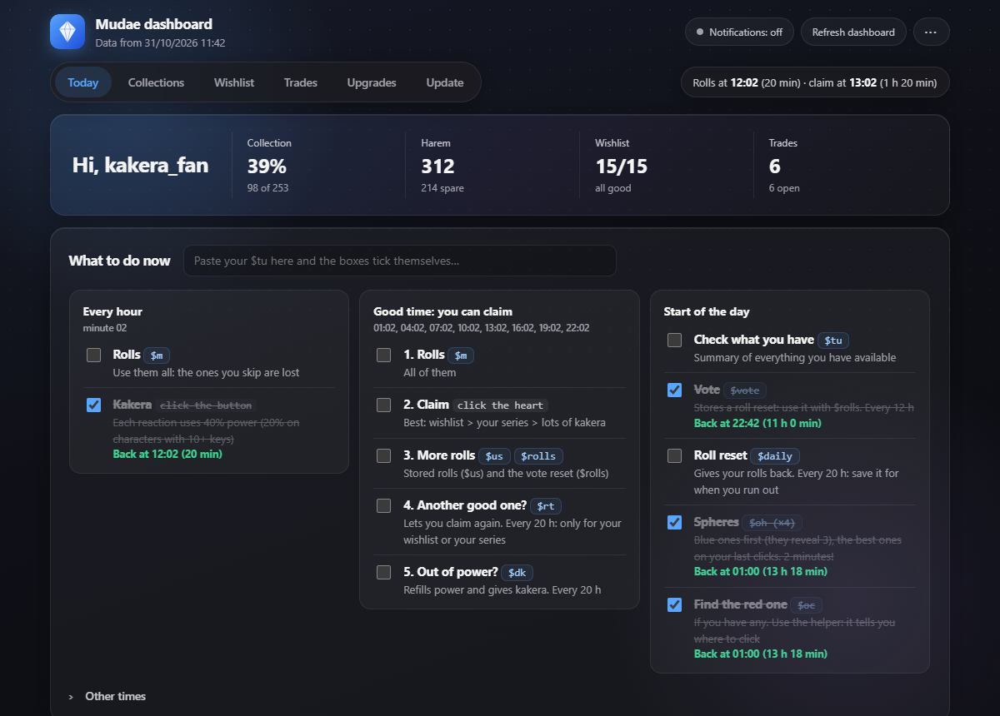
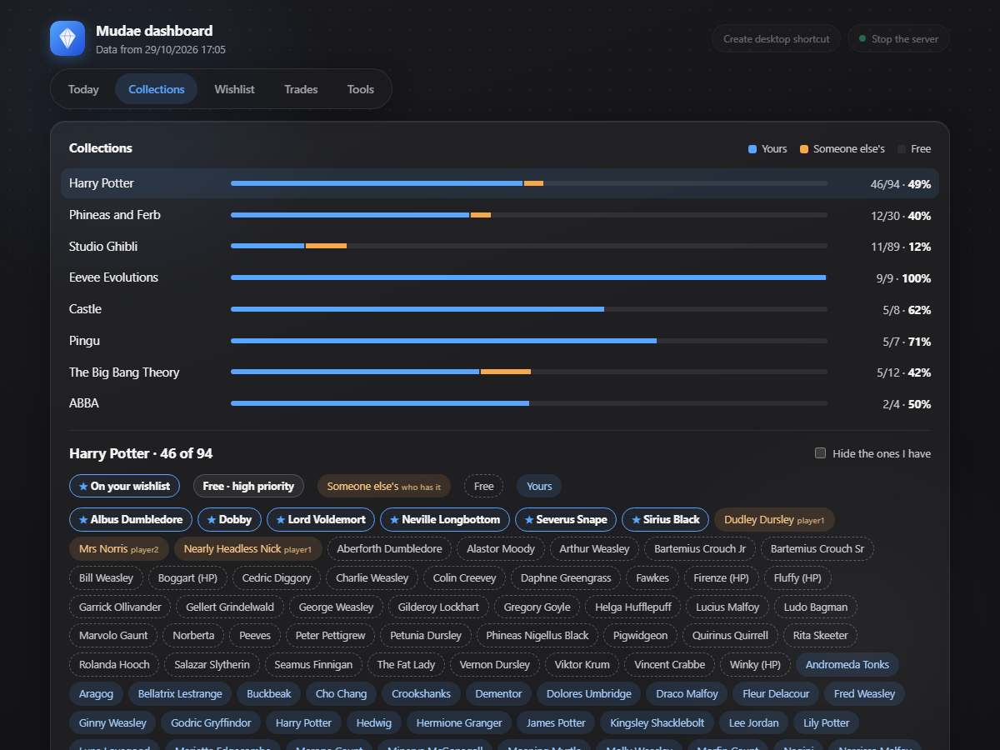
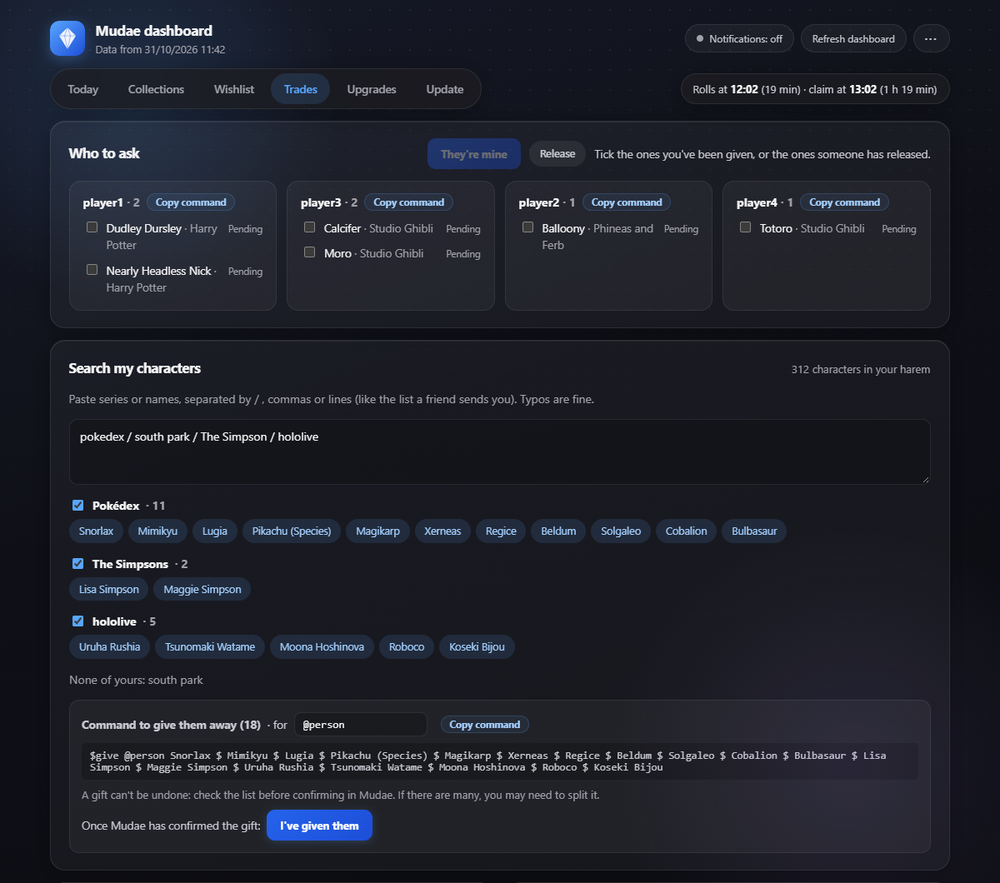

<p align="center"></p>

# Mudae Dashboard

[English](README.md) · [Català](README.ca.md) · **Español**

Lleva tus colecciones de [Mudae](https://mudae.net) al día sin perder ninguna tirada.

Un panel que se ejecuta en tu ordenador para el bot de Discord Mudae: pegas lo que te manda Mudae y te lleva las colecciones, la wishlist y los intercambios. Disponible en castellano, catalán e inglés.

<p align="center">
  
  
  
</p>

_Capturas del panel con datos de ejemplo._

## Instalación (5 minutos)

1. Instala [Python](https://www.python.org/downloads/) 3.12 o más nuevo. En la primera pantalla del instalador, marca «Add python.exe to PATH» (recomendado, aunque sin él también funciona).
2. Haz clic en el botón verde **Code → Download ZIP** arriba de esta página. Antes de descomprimirlo: clic derecho al ZIP → **Propiedades** → marca **«Desbloquear»** → Aceptar (si no, Windows puede bloquear los `.bat`). Después descomprime la carpeta donde la quieras tener (por ejemplo, en Documentos). No la abras desde dentro del zip.
3. Doble clic en **`Configura.bat`**. Elige el idioma (el 2 es el español), escribe tu nombre en Mudae (el que sale en «Pertenece a …» en tus personajes) y, si quieres, el del servidor. Crea el acceso directo **Mudae** en el escritorio y abre el panel.
4. En el panel, pega lo que te envía Mudae en la casilla de arriba de la pestaña **Hoy**. Adivina qué es cada mensaje y lo guarda solo. Por orden:
   - **Tu harem**: escribe `$mma+s` en Discord, copia el mensaje que te llega por privado y pégalo.
   - **Tu wishlist**: `$wl`.
   - **Cada serie que coleccionas**: `$imaso <serie>` (por ejemplo, `$imaso Harry Potter`). Una serie nueva te espera: comprueba su nombre en «Poner al día» y pulsa **Guardar y actualizar**.
   - **Después, todas de golpe**: en «Poner al día», elige «Todas tus series», copia el comando que sale (`$imaa+os Serie 1 $ Serie 2 $ …`) y pega todos los mensajes que te devuelve Mudae.
   - **Tu servidor y tú**: el recuadro **¡Pendiente!**, debajo de la casilla, dice qué comandos faltan (`$tu`, `$settings`, `$bonus`, `$k`…). Pégalos igual.

A partir de aquí, abre el panel con el acceso directo **Mudae** del escritorio.

## Funciones

- **Pestaña Hoy:** pegas cualquier respuesta de Mudae y una lista te dice qué toca ahora.
- **Reloj de tiradas y reclamo** con avisos cuando vuelven las tiradas, el reclamo, el `$daily`, el `$vote`, el `$dk`, el `$rt` o el `$p`.
- **Ayudantes del `$oc` y el `$oq`:** te dicen en qué casilla hacer clic en los juegos de esferas.
- **Colecciones:** un álbum por serie, con los personajes libres y quién tiene los demás.
- **Colecciones especiales:** agrupa los personajes que quieras, aunque no sean de una serie de Mudae.
- **Wishlist:** te avisa de los que ya son tuyos o que ha reclamado alguien, y te prepara los comandos.
- **Intercambios y regalos:** prepara el comando `$give` y busca entre tus personajes.
- **Mejoras:** te dice qué insignia, piso de la torre o ventaja de esferas comprar después.
- **Pokédex:** cuenta tus Pokémon por rareza.
- **Excel:** lo mismo en una hoja de cálculo que respeta tus notas.

Más detalle, uso diario, configuración y problemas en la [guía](docs/guide.es.md).

## Conviene saber

- **Sin conexión:** no se conecta a Discord ni a Mudae y no pide ninguna cuenta. Solo lee lo que pegas y lo guarda en la carpeta `dades/`.
- **Cierra el Excel** antes de usar los botones del panel: si está abierto, no se puede guardar.
- Los botones usan un pequeño servidor que solo escucha en tu ordenador (`127.0.0.1`). Se para solo unos minutos después de cerrar la pestaña.
- **No borres la carpeta `lib`**: tiene lo que necesita el programa para escribir el Excel.

## Estructura del proyecto

<details>
<summary>Archivos</summary>

| Archivo | Qué hace |
| --- | --- |
| `mudae.py` | todo el programa, con la librería estándar de Python y openpyxl. Lee `dades/`, escribe el Excel y `dashboard.html`, y hace de servidor local. |
| `i18n.py` | los textos en español e inglés (el catalán hace de clave). |
| `oc.html` | el ayudante del `$oc`, sin dependencias. |
| `oq.html` | el ayudante del `$oq`, sin dependencias. |
| `lib/` | openpyxl y et_xmlfile, incluidos para que funcione sin `pip install`. |
| `Configura.bat` / `Actualitza.bat` | la primera configuración y el acceso directo. |

Pruebas:

```bash
python -m unittest discover tests
node tests/test_oc.mjs
node tests/test_rutina.mjs
node tests/test_millores.mjs
```

Textos sin traducir: `python tools/textos.py`. Un `.zip` limpio para pasárselo a alguien (sin datos personales): `python tools/fer_zip.py`.

</details>

## Datos y licencias

- Código: [MIT](LICENSE).
- Librerías incluidas: openpyxl y et_xmlfile, ambas MIT (los textos de licencia están en `lib/*.dist-info/`).
- Proyecto de fans: no tiene relación con Mudae ni Discord, que no lo avalan; sus nombres son marcas de sus propietarios.

## Versión

No hay versiones numeradas: el botón **Actualizar el panel** instala la última versión de GitHub.

---

Developed by [Vlarac](https://github.com/Vlarac03)
