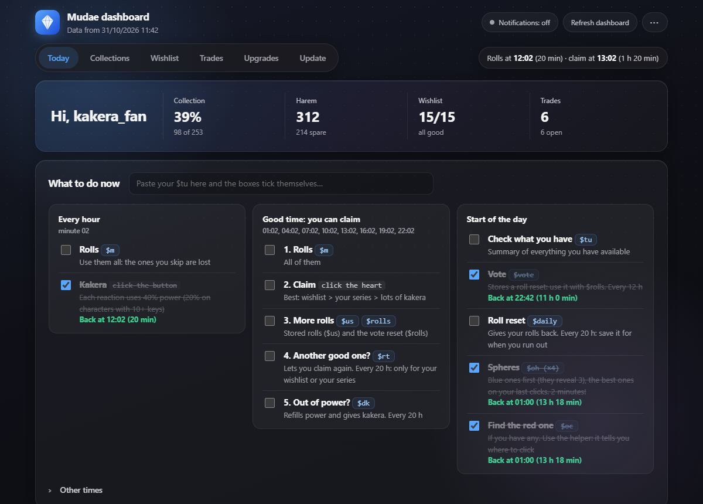
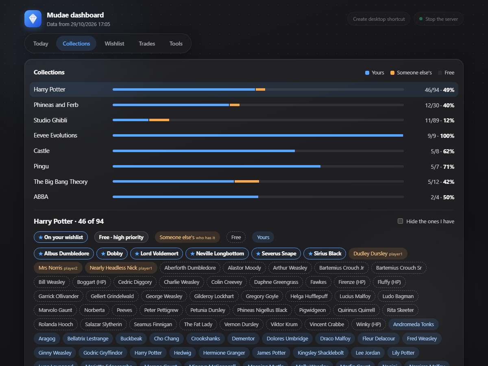
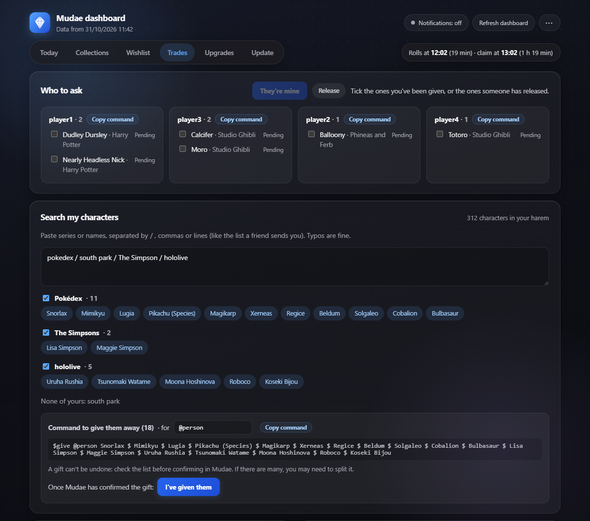

<p align="center"></p>

# Mudae Dashboard

**English** · [Català](README.ca.md) · [Español](README.es.md)

Keep your [Mudae](https://mudae.net) collections up to date without missing a roll.

A dashboard that runs on your own computer for the Mudae Discord bot: paste what Mudae sends you and it tracks your collections, wishlist and trades. Available in English, Catalan and Spanish.

<p align="center">
  
  
  
</p>

_Screenshots of the dashboard with sample data._

## Install (5 minutes)

1. Install [Python](https://www.python.org/downloads/) 3.12 or newer. On the first screen of the installer, tick «Add python.exe to PATH» (recommended, though it also works without it).
2. Click the green **Code → Download ZIP** button at the top of this page. Before unzipping it: right-click the ZIP → **Properties** → tick **«Unblock»** → OK (otherwise Windows may block the `.bat` files). Then unzip the folder somewhere you'll keep it (for example, Documents). Don't run it from inside the zip.
3. Double-click **`Configura.bat`**. Choose your language (English by default), then type your Mudae name (the one in «Belongs to …» on your characters) and, if you want, your server's name. It creates a **Mudae** shortcut on your desktop and opens the dashboard.
4. In the dashboard, paste what Mudae sends you into the box at the top of the **Today** tab. It works out what each message is and saves it by itself. In this order:
   - **Your harem**: type `$mma+s` in Discord, copy the message Mudae sends you by DM and paste it.
   - **Your wishlist**: `$wl`.
   - **Each series you collect**: `$imaso <series>` (for example `$imaso Harry Potter`). A new series waits for you: check its name in «Update» and click **Save and update**.
   - **Then, all at once**: in «Update», choose «All your series», copy the command it shows (`$imaa+os Series 1 $ Series 2 $ …`) and paste every message Mudae sends back.
   - **Your server and you**: the **To do!** box under the paste box lists the commands still missing (`$tu`, `$settings`, `$bonus`, `$k`…). Paste them the same way.

From then on, open the dashboard with the **Mudae** shortcut on your desktop.

## Features

- **Today tab:** paste any Mudae reply and a checklist shows what to do now.
- **Roll and claim clock** with notifications when rolls, claim, `$daily`, `$vote`, `$dk`, `$rt` or `$p` are ready.
- **`$oc` and `$oq` helpers:** they tell you which square to click in the sphere games.
- **Collections:** one album per series, with the free characters and who owns the rest.
- **Custom collections:** group any characters, even outside a Mudae series.
- **Wishlist:** warns about characters you own or someone else claimed, and builds the commands.
- **Trades and gifts:** builds the `$give` command and searches your characters.
- **Upgrades:** tells you which badge, tower floor or sphere perk to get next.
- **Pokédex:** counts your Pokémon by rarity.
- **Excel:** the same data in a workbook that keeps your own notes.

More detail, daily use, settings and troubleshooting in the [guide](docs/guide.md).

## Good to know

- **Offline:** it doesn't connect to Discord or Mudae and needs no account. It only reads what you paste and saves it in the `dades/` folder.
- **Close the Excel file** before using the dashboard buttons: it can't be saved while it's open.
- The buttons use a small server that only listens on your own computer (`127.0.0.1`). It stops by itself a couple of minutes after you close the tab.
- **Don't delete the `lib` folder**: it has what the program needs to write the Excel file.

## Project structure

<details>
<summary>Files</summary>

| File | What it does |
| --- | --- |
| `mudae.py` | the whole program, using the Python standard library and openpyxl. Reads `dades/`, writes the Excel file and `dashboard.html`, and runs the local server. |
| `i18n.py` | Spanish and English texts (the Catalan text is the key). |
| `oc.html` | the `$oc` helper, with no dependencies. |
| `oq.html` | the `$oq` helper, with no dependencies. |
| `lib/` | openpyxl and et_xmlfile, bundled so it works without `pip install`. |
| `Configura.bat` / `Actualitza.bat` | first-time setup and the desktop shortcut. |

Tests:

```bash
python -m unittest discover tests
node tests/test_oc.mjs
node tests/test_rutina.mjs
node tests/test_millores.mjs
```

Missing translations: `python tools/textos.py`. Clean zip to share (no personal data): `python tools/fer_zip.py`.

</details>

## Data and licences

- Code: [MIT](LICENSE).
- Bundled libraries: openpyxl and et_xmlfile, both MIT (licence texts in `lib/*.dist-info/`).
- Fan project: not affiliated with or endorsed by Mudae or Discord, whose names are trademarks of their owners.

## Version

No numbered releases: the **Refresh dashboard** button installs the latest version from GitHub.

---

Developed by [Vlarac](https://github.com/Vlarac03)
