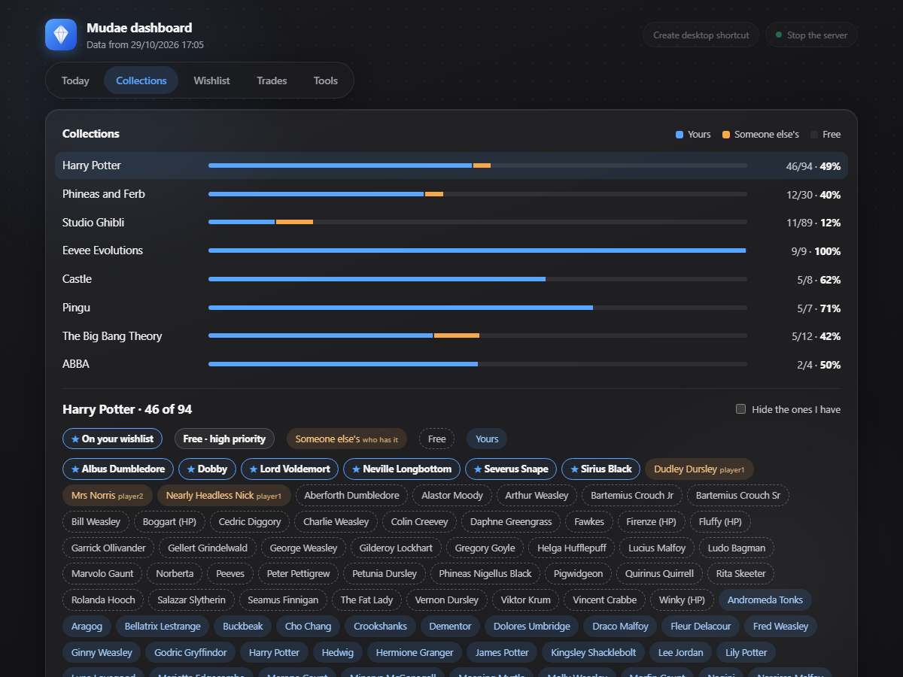
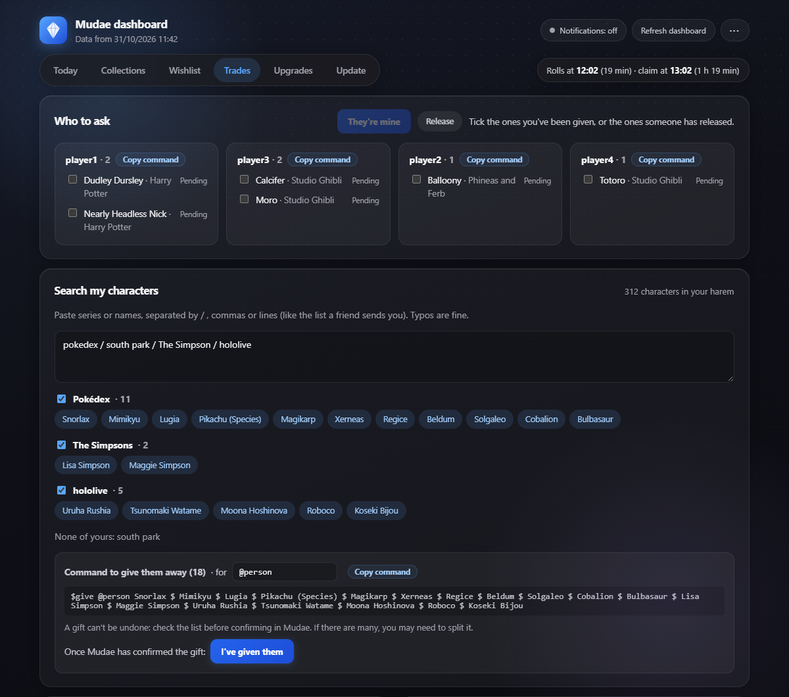

# Mudae Dashboard: guía

[English](guide.md) · [Català](guide.ca.md) · **Español**

Vuelve al [README](../README.es.md).

## Qué hace

- **Pestañas por orden de uso**: Hoy, Colecciones, Wishlist, Intercambios, Mejoras y Poner al día. El reloj de tiradas y reclamo se ve desde todas, los avisos te llevan a la pestaña donde se arreglan, y los bloques largos se pliegan y se quedan abiertos o cerrados como los dejaste.
- **Una sola casilla para todo**: arriba de la pestaña Hoy pegas cualquier mensaje de Mudae (`$tu`, `$settings`, `$bonus`, `$k`, `$kt`, `$opp`, `$opz`, `$os`, `$mmy=`, `$mma+s`, `$wl`, `$imaso`…) y el panel lo lee en cuanto lo pegas, sin ningún botón, y lo envía donde toca. Debajo hay un botón para copiar cada comando que entiende y un recuadro **¡Pendiente!** con los comandos que aún le faltan: no supone nada de lo que depende de tu servidor o de ti (horas de tiradas y reclamos, horas del `$rt`, huecos de la wishlist, precios de las insignias y de la torre). El harén, la wishlist y las series se guardan enseguida; una serie nueva o una colección especial te espera en «Poner al día» para que la compruebes.
- **Qué toca ahora**: pegas el `$tu` y la lista se marca sola, Pokéslot (`$p`) incluido. Funciona como una cola: en «Ahora» solo está lo que puedes hacer, primero lo más importante (el reclamo arriba cuando puedes reclamar, luego las tiradas y el kakera de cada hora, lo que es una vez al día y los comodines que guardas para cuando hagan falta: `$rt`, `$dk`), lo que ya has hecho se esconde hasta que lo puedes volver a hacer, y un recuadro «Estado» te dice sí o no del reclamo, las tiradas, el kakera (con cuántas reacciones te da el poder), el Pokéslot, el `$rt` y el `$dk`, y cuándo vuelve cada cosa (`$daily` y `$dk` cada 20 h, `$vote` cada 12 h, `$oh` a medianoche UTC, tiradas en el minuto de tu servidor…). El minuto de las tiradas y el próximo reclamo salen del `$tu`, cada cuánto hay reclamo del `$settings` y las horas del `$rt` del `$bonus`.
- **Notificaciones**: mientras el panel está abierto, te avisa cuando vuelves a tener tiradas (y te dice si puedes reclamar y reaccionar a kakera), y cuando vuelves a tener el reclamo, el `$daily`, el `$vote`, el `$dk`, el `$rt` o el `$p`. Suenan y se quedan en pantalla hasta que las cierras. Se activan y se desactivan con el botón **Notificaciones** de arriba.
- **Ayudante del `$oc`**: marcas los colores que salen y te dice en qué casilla hacer clic para encontrar la roja. Está plegado en la pestaña Hoy: se abre con un clic.
- **Ayudante del `$oq`**: marcas los colores que salen (cada uno dice cuántas púrpuras toca) y te muestra las posibilidades de púrpura de cada casilla oculta y en cuál hacer clic para encontrar 3 púrpuras. Plegado al lado del ayudante del `$oc`.
- **Colecciones**: un álbum por serie con tus personajes, los libres, los de la wishlist y los de otros jugadores (y de quién son). Haces clic en los que consigues para marcarlos como tuyos.
- **Qué tirar (`$h`, `$w` o `$m`)**: en «Poner al día» elige Hombres, Mujeres y Ambos y pega la respuesta de `$imaa+osh= Serie 1 $ Serie 2`, `$imaa+osw= …` y `$imaa+oswh …` (una sola vez: el género no cambia). En Hoy, la tarjeta «Qué tirar» dice si tirar hombres, mujeres o mixto para completar series, para hacer llaves (donde tienes más proporción de personajes) o según las X que tienes con más llaves (`$mmy=`), para todas las series o para una. En Colecciones, cada serie muestra el detalle.
- **Colecciones especiales**: un grupo que eliges tú, aunque no sea una serie de Mudae (por ejemplo, los Eevee de la Pokédex). Escribes el nombre y los personajes, y el `$imaso` de la serie de la que salen te pone de quién es cada uno.
- **Pokédex**: pegas el `$pd sumrare` (un solo mensaje) y ves cuántos Pokémon tienes de cada rareza. Si pegas el mensaje del tiempo que falta para el próximo `$p`, se marca la tarea del Pokéslot.
- **Mejoras**: pegas el `$k`, el `$kt`, un `$opp <personaje>`, el `$os`, el `$mmy=` o el `$bonus` y te dice qué insignia, qué piso de la torre, qué mejora de esferas y qué mejora de la tienda de esferas te toca, y cuánta kakera te falta. El `$bonus` añade un resumen: cuántos botones de kakera haces con el poder lleno, las esferas del primer `$oh`, las horas del `$rt` y los huecos de la wishlist. Los precios solo salen de lo que pegas (`$k`, `$kt`), porque cada servidor tiene los suyos. Para las esferas: primero la mejora 10 en todos los personajes que no vayas a regalar (hasta 100), las 1-9 solo en los que te salen a menudo, un plan con el `$or` cuando sale a cuenta, y te dice cuándo parar y pasar a la tienda de esferas. Su casilla funciona como la de Hoy. Cuando puedes pagar la insignia, el piso de la torre o la mejora de esferas que te recomienda (con el kakera y las esferas del último `$tu`), la pestaña Hoy te lo dice arriba, con un botón que te lleva a esa tarjeta. Cada recomendación tiene un botón **Hecho** (con **Deshacer**): apunta el nivel nuevo y descuenta lo que cuesta de la kakera o las esferas, sin volver a pegar. Tras cada pegado te dice qué ha entendido, y te avisa cuando lo que pegaste tiene más de una semana.
- **Wishlist**: te avisa de los que ya son tuyos o que ha reclamado alguien, y te prepara los comandos `$wishremove` y `$wish`.
- **Intercambios y regalos**: el comando `$give` para cada jugador, y un buscador que entiende listas de series mal escritas («full metal alchimist», «Rezero»…).
- **Poner al día**: pegas el `$mma+s` (tu harem, con la serie de cada personaje), el `$wl` o un `$imaso` y se guarda en cuanto lo pegas (una serie nueva o una colección especial te espera para que la compruebes y pulses el botón). Te avisa si hace más de una semana que no pones al día el harem. Una caja de **Copia de seguridad** baja lo que el panel recuerda en el navegador (Mejoras, reloj, Pokédex…) y lo restaura, por si borras el navegador o lo cambias.
- **Comandos de uso habitual**: por temas (tiradas, reclamar, tu colección, harén y perfil, intercambios, esferas, torre, kakera, Pokéslot…), cada grupo plegado, con un buscador («wish», «kakera»…), lo que hace cada comando y un botón de copiar.
- **Excel**: lo mismo en una hoja de cálculo, que respeta lo que escribes en ella (prioridades, notas, estado de los intercambios).

| Colecciones | Intercambios y regalos |
|---|---|
|  |  |

## Cada día

- **Qué toca ahora** te dice qué hacer y cuándo. Ve marcando lo que haces.
- **Cuando consigas un personaje**: en «Colecciones», elige la serie, haz clic en él y en **Ya son míos**.
- **Cuando regales**: en «Intercambios» → «Buscar entre los míos», búscalos, copia el `$give` y, cuando Mudae lo confirme, haz clic en **Ya los he dado**.
- **Una vez por semana**: vuelve a pegar el `$mma+s` en la casilla de Hoy (el panel te avisa).

## Configuración (`dades/config.json`)

| Clave | Qué es |
|---|---|
| `usuari` | Tu nombre en Mudae. Lo pone `Configura.bat`. |
| `idioma` | `es`, `ca` o `en`. Para cambiarlo, vuelve a abrir `Configura.bat`. |
| `servidor` | Opcional: sale en el título del panel y del Excel. |
| `discord_id` | Opcional: el número que te da `$myid`, para que los comandos `$give` que copias te mencionen bien. |
| `preferits` | Opcional: personajes que el panel te propone primero cuando se libera un hueco en la wishlist, por ejemplo `["Fawkes", "Howl"]`. |

## Si algo no va

- **«Could not update»**: cierra el Excel y vuelve a abrir Mudae.
- **Un botón dice «Sin conexión» o «Botón apagado»**: abre el panel con el acceso directo Mudae, no abriendo `dashboard.html` directamente.
- **Windows dice «Control Inteligente de Aplicaciones ha bloqueado un archivo»** (o SmartScreen avisa) al abrir un `.bat`: borra la carpeta, haz clic derecho al ZIP → Propiedades → **Desbloquear** y vuelve a descomprimirlo (paso 2).
- **«Python 3.12 or newer is needed»** al abrir `Configura.bat`: instala Python (paso 1) y vuelve a probar.
