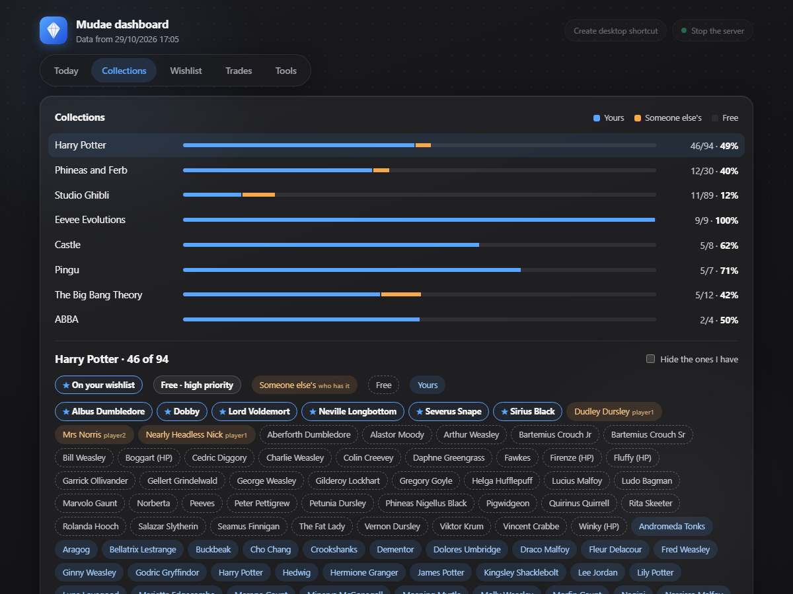
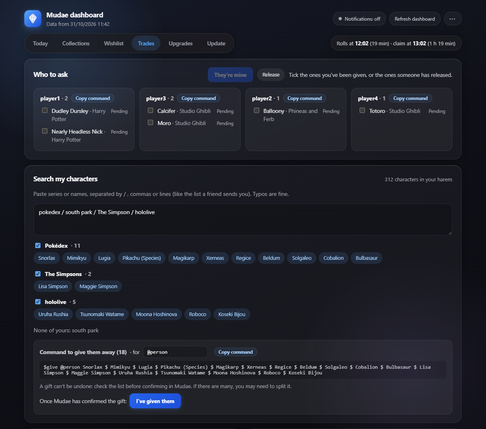

# Mudae Dashboard: guide

**English** · [Català](guide.ca.md) · [Español](guide.es.md)

Back to the [README](../README.md).

## Features

- **Tabs in the order you use them**: Today, Collections, Wishlist, Trades, Upgrades and Update. The roll and claim clock stays above the tabs, alerts take you to the tab where you fix them, and long sections fold away and stay open or closed the way you left them.
- **One box for everything**: paste any Mudae message at the top of the Today tab (`$tu`, `$settings`, `$bonus`, `$k`, `$kt`, `$opp`, `$opz`, `$os`, `$mmy=`, `$mma+s`, `$wl`, `$imaso`…) and the dashboard reads it as soon as you paste it, with no button, and sends it where it belongs. Under it, a copy button for each command it understands and a **To do!** box with the commands it still needs: nothing that depends on your server or on you is assumed (roll and claim times, `$rt` hours, wishlist slots, badge and tower prices). Harem, wishlist and series are saved straight away; a new series or a custom collection waits in «Update» for you to check it.
- **What to do now**: paste your `$tu` and the checklist ticks itself, Pokéslot (`$p`) included. It works like a queue: «Now» shows only what you can do, most important first (the claim on top when you can claim, then the hourly rolls and kakera, then once-a-day tasks and the spares you keep for when you need them: `$rt`, `$dk`), what you've done hides until you can do it again, and a «Status» box says yes or no for claim, rolls, kakera (with how many reactions your power gives), Pokéslot, `$rt` and `$dk`, and when each comes back (`$daily` and `$dk` every 20 h, `$vote` every 12 h, `$oh` at midnight UTC, rolls at your server's minute…). The roll minute and the next claim come from your `$tu`, how often claims reset from `$settings`, and the `$rt` hours from `$bonus`.
- **Notifications**: while the dashboard is open, it tells you when your rolls are back (and whether you can claim and react to kakera), and when your claim, `$daily`, `$vote`, `$dk`, `$rt` or `$p` are ready again. They beep and stay on screen until you close them. Turn them on and off with the **Notifications** button at the top.
- **`$oc` helper**: mark the colors that appear and it tells you which square to click to find the red sphere. It's folded on the Today tab: open it with a click.
- **`$oq` helper**: mark the colors that appear (each one says how many purple spheres it touches) and it shows the chance of purple on every hidden square and which one to click to find 3 purple ones. Folded next to the `$oc` helper.
- **Collections**: one album per series with your characters, the free ones, the ones on your wishlist and the ones other players own (and who). Click the ones you get to mark them as yours.
- **What to roll (`$h`, `$w` or `$m`)**: in «Catch up» choose Men, Women and Both and paste the reply to `$imaa+osh= Series 1 $ Series 2`, `$imaa+osw= …` and `$imaa+oswh …` (only once: gender doesn't change). On Today, the «What to roll» card says whether to roll men, women or mixed to complete series, to farm keys (where you own the larger share) or by the X characters you have the most keys on (`$mmy=`), for all series or one. In Collections, each series shows the detail.
- **Custom collections**: a group you pick, even if it isn't a Mudae series (for example, the Eevees from the Pokédex). Type its name and characters, and the `$imaso` of the series they come from fills in who owns each one.
- **Pokédex**: paste your `$pd sumrare` (one message) and see how many Pokémon you have of each rarity. Pasting the «time left before your next `$p`» message ticks the Pokéslot task.
- **Upgrades**: paste your `$k`, `$kt`, `$opp <character>`, `$os`, `$mmy=` or `$bonus` and it tells you which badge, tower floor, sphere perk and sphere shop upgrade to get next, and how much kakera you still need. The `$bonus` adds a summary: how many kakera buttons a full power bar covers, the spheres your first `$oh` gives, your `$rt` hours and your wishlist slots. Prices only come from what you paste (`$k`, `$kt`), since each server sets its own. For spheres: perk 10 first on every character you keep (up to 100), perks 1-9 only on the ones you roll often, a `$or` refund plan when it pays off, and it tells you when to stop and move to the sphere shop. Its paste box works like the Today one. When you can afford the next recommended badge, tower floor or sphere upgrade (with the kakera and spheres from your last `$tu`), the Today tab tells you at the top, with a button that takes you to that card. Each recommendation has a **Done** button (with **Undo**): it records the new level and takes the cost off your kakera or spheres, so you don't have to paste again. After every paste it tells you what it understood, and it warns you when something you pasted is over a week old.
- **Wishlist**: warns you about characters you already own or someone else claimed, and builds the `$wishremove` and `$wish` commands for you.
- **Trades and gifts**: the `$give` command for each player, and a search box that understands misspelled series lists («full metal alchimist», «Rezero»…).
- **Update**: paste your `$mma+s` (your harem, with each character's series), `$wl` or an `$imaso` and it's saved as soon as you paste it (a new series or a custom collection waits for you to check it and click the button). It reminds you if your harem is more than a week old. A **Backup** box downloads what the dashboard remembers in your browser (Upgrades, clock, Pokédex…) and restores it, in case you clear the browser or switch.
- **Common commands**: grouped by topic (rolls, claims, your collection, harem and profile, trades, spheres, tower, kakera, Pokéslot…), each group folded, with a search box («wish», «kakera»…), what each command does and a copy button.
- **Excel**: the same in a spreadsheet, which keeps what you type in it (priorities, notes, trade status).

| Collections | Trades and gifts |
|---|---|
|  |  |

## Every day

- **What to do now** tells you what to do and when. Tick things as you do them.
- **When you get a character**: in «Collections», choose the series, click it and click **They're mine**.
- **When you give characters away**: in «Trades» → «Search my characters», find them, copy the `$give` command and, once Mudae confirms it, click **I've given them**.
- **Once a week**: paste your `$mma+s` again in the Today box (the dashboard reminds you).

## Settings (`dades/config.json`)

| Key | What it is |
|---|---|
| `usuari` | Your Mudae name. Set by `Configura.bat`. |
| `idioma` | `en`, `es` or `ca`. Run `Configura.bat` again to change it. |
| `servidor` | Optional: shown in the dashboard and Excel titles. |
| `discord_id` | Optional: the number `$myid` gives you, so the `$give` commands you copy mention you properly. |
| `preferits` | Optional: characters the dashboard suggests first when a wishlist slot frees up, for example `["Fawkes", "Howl"]`. |

## Troubleshooting

- **«Could not update»**: close the Excel file and open Mudae again.
- **A button says «No connection» or «Button off»**: open the dashboard with the Mudae shortcut, not by opening `dashboard.html` directly.
- **Windows says «Smart App Control blocked a file»** (or SmartScreen warns you) when opening a `.bat`: delete the folder, right-click the ZIP → Properties → **Unblock** and unzip it again (step 2).
- **«Python 3.12 or newer is needed»** when opening `Configura.bat`: install Python (step 1) and try again.
